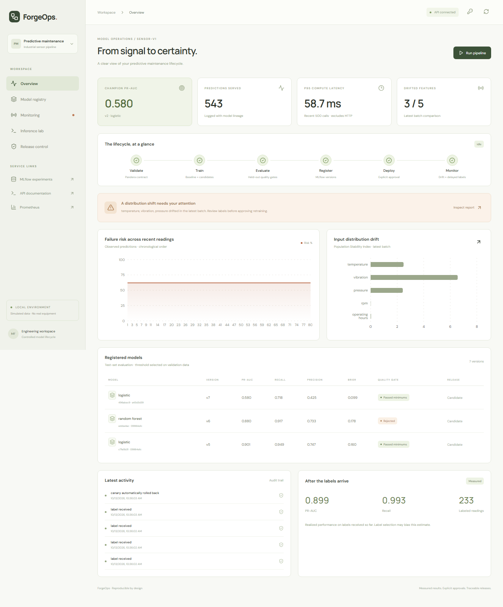
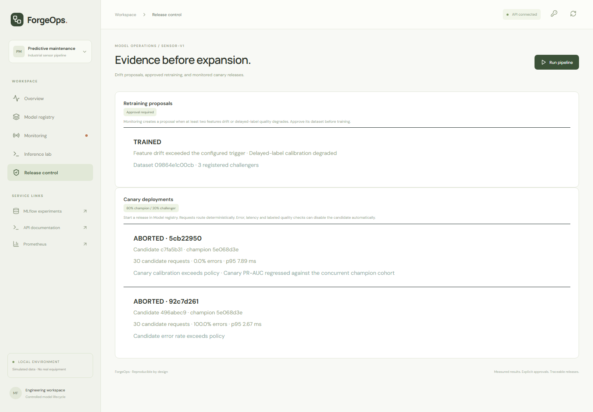
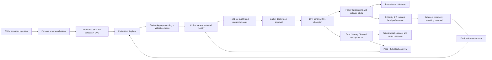

# ForgeOps — End-to-End MLOps Platform

[](https://github.com/Emad0b/production-mlops-platform/actions/workflows/ci.yml)


A predictive maintenance platform that closes the loop between validated data, tracked training, drift monitoring, approved retraining, and canary deployment. A model can pass offline evaluation and still be rejected by live rollout checks. This repository demonstrates that failure path with reproducible evidence.

**FastAPI · PostgreSQL · Pandera · DVC · Prefect · Scikit-learn · MLflow · Prometheus · Grafana · Evidently · Docker · GitHub Actions**



## The demonstration

1. Generate 4,000 reproducible sensor readings; validate the schema and version the dataset.
2. Train a fixed baseline, logistic regression, and a tuned random forest. MLflow records parameters, signatures, artifacts, metrics, dataset hashes, and registry versions.
3. Reject the weak baseline and explicitly approve an initial champion.
4. Inject temperature, vibration, and pressure drift. Evidently produces an interactive report; configured criteria create a retraining proposal.
5. Approve the new dataset. Prefect trains three challengers; static evaluation gates reject two.
6. Route 20% of fresh labeled traffic to the remaining challenger. Its observed calibration and PR-AUC fail policy, so the platform disables its traffic and retains the champion.
7. Separately inject inference errors into a control release. After 30 candidate failures, the same automatic rollback mechanism disables that release.

The fault control is a distinct MLflow version of the **same evaluated champion artifact**, clearly identified in the report. It is used to isolate deployment safety from training quality.



## Measured results

Results are from self-authored **simulated equipment data**, not a validated real-world failure forecast. The target describes a simulated event associated with a sensor reading; no future prediction horizon is claimed.

- Initial champion: PR-AUC **0.580**, recall **0.718**, precision **0.425**, Brier **0.099** on 800 held-out readings.
- Retrained logistic challenger: held-out PR-AUC **0.901**, Brier **0.160** on 240 shifted readings; passed static gates.
- Fresh canary traffic: 163 total requests / 30 candidate labels; candidate Brier **0.222** exceeded the **0.18** rollout limit. Its PR-AUC **0.781** also fell below the concurrent champion cohort's **0.935**, beyond the allowed margin.
- Inference fault demonstration: **30 candidate errors → automatic rollback**, champion preserved.
- Local HTTP smoke benchmark: **200/200 successful requests**, concurrency 8, p95 **283 ms**, throughput **83 req/s**. This is a small local benchmark, not a capacity guarantee. HTTP timing includes queueing and network overhead; the canary compute-latency check measures the prediction operation.

Inspect the raw evidence: [initial training](reports/demo-results.json), [Prefect retraining and fault rollback](reports/lifecycle-demo.json), [real challenger rejection](reports/rollout-demo.json), and [HTTP benchmark](reports/load-test.json). UUIDs and timestamps in committed reports describe the recorded run; each fresh demonstration produces new identifiers.

## Architecture



Operational metadata, predictions, labels, rollout observations, and audit events live in PostgreSQL in Docker. SQLite provides a lightweight local profile. MLflow uses a separate SQLite tracking store and a shared artifact volume in this demonstration. DVC pointers version data independently of Git; no dataset or credentials are committed.

## Run with Docker

Requires Docker Compose and Python for generating development secrets.

```bash
python scripts/init_env.py
docker compose up --build -d
docker compose exec -T api python scripts/bootstrap.py
docker compose exec -T api python scripts/demo_lifecycle.py
docker compose exec -T api python scripts/demo_rollout.py
```

Open the dashboard at **http://localhost:5176**, API docs at **http://localhost:8200/docs**, MLflow at **http://localhost:5001**, Prometheus at **http://localhost:9091**, and Grafana at **http://localhost:3001**. Grafana provisions the **ForgeOps · Model Lifecycle** dashboard automatically; anonymous access is read-only.

For dashboard mutations, use the `MLOPS_ADMIN_TOKEN` from your local `.env` in the key panel. The token stays in browser memory and is sent only with administrative requests. The demo scripts perform explicit local approvals; the service itself does not automatically approve deployments.

Enable the Prefect scheduler after bootstrapping:

```bash
docker compose --profile worker up -d
```

Prefect runs at **http://localhost:4200**. The worker reviews pending proposals every minute and trains only the currently approved dataset. Inspect a newly ingested batch with the monitoring API or `scripts/run_flow.py`; the scheduler does not invent new incoming data.

## Run locally

Create and activate a Python 3.12 virtual environment, then:

```bash
pip install -e ".[orchestration,versioning]"
python scripts/bootstrap.py
python scripts/demo_lifecycle.py
python scripts/demo_rollout.py
```

Set `MLOPS_ADMIN_TOKEN` to the private value in `runtime/admin-token.txt`, then start the API:

```bash
uvicorn mlops_platform.serving.main:app --host 127.0.0.1 --port 8200
```

In another terminal:

```bash
cd frontend
npm ci
npm run dev
```

PowerShell token setup: `$env:MLOPS_ADMIN_TOKEN = Get-Content runtime/admin-token.txt`.

The local profile writes operational data, model artifacts, and Prefect state under `runtime/`. To serve the local MLflow store, run `mlflow server --backend-store-uri sqlite:///runtime/mlflow.db --host 127.0.0.1 --port 5001 --workers 1` from the repository root.

## Lifecycle policies

- **Validation:** finite feature values, allowed ranges, binary labels, unique record identifiers, immutable dataset checksum verification.
- **Training:** chronological 60/20/20 split; preprocessing fit on training only; forest depth and classification threshold selected on validation data. Held-out test data is used for release gates.
- **Static gates:** [configs/gates.json](configs/gates.json) sets PR-AUC, recall, precision, calibration, and regression limits. Different datasets require evaluation of the champion on the candidate's holdout, with a training-overlap check.
- **Retraining:** [configs/retraining.json](configs/retraining.json) triggers on at least two drifted features or recent labeled performance degradation. Dataset approval and a one-hour cooldown guard automatic training.
- **Canary:** [configs/rollout.json](configs/rollout.json) routes 20% of requests using a deterministic hash of `X-Request-Id`. Checks require at least 30 candidate observations; full rollout also requires at least 30 labels and both classes in each concurrent cohort.
- **Rollback:** failed error, p95 compute latency, or labeled quality checks disable candidate traffic. The champion alias remains unchanged. Successful full rollout requires a second explicit approval and rechecks offline gates; the previous approved version remains available for rollback.

## API examples

```bash
curl http://localhost:8200/api/predict \
  -H 'Content-Type: application/json' \
  -H 'X-Request-Id: equipment-42-reading-1' \
  -d '{"temperature":82,"vibration":4.2,"pressure":5.3,"rpm":1850,"operating_hours":8200}'

curl http://localhost:8200/api/datasets/ingest \
  -H "X-Admin-Token: $MLOPS_ADMIN_TOKEN" \
  -H 'Content-Type: text/csv' --data-binary @readings.csv
```

CSV columns: `record_id,timestamp,temperature,vibration,pressure,rpm,operating_hours,failure`. Maximum upload size is 5 MB. Ingestion validates and saves the dataset without approving it.

Administrative endpoints include `/api/datasets/approve`, `/api/train`, `/api/monitor`, `/api/retraining/{proposal_id}/train`, `/api/rollouts/start`, `/api/rollouts/{rollout_id}/complete`, `/api/rollouts/{rollout_id}/abort`, and `/api/labels`. `/api/models/promote` bootstraps the initial champion only; subsequent API releases must use a canary. OpenAPI documents the request schemas.

Version an ingested dataset with `python scripts/version_dataset.py DATASET_SHA256`. The script creates real DVC cache objects and `.csv.dvc` pointers in `versioned/`. A fresh clone can regenerate the deterministic demonstration data; an external DVC remote is intentionally not configured. Set a remote yourself before sharing non-demo datasets, and keep its credentials in local configuration.

## Verification

```bash
python -m pytest -q
cd frontend
npm run build
npx playwright install chromium
npm run test:e2e
```

Browser tests require a running API/dashboard and bootstrapped data. Tests cover validation, leakage prevention, quality gates, MLflow versions/aliases, predictions, labels, drift, deterministic routing, approval enforcement, canary rollback, proposal cooldown, and successful full rollout with labeled cohorts. GitHub Actions also exercises PostgreSQL, the Docker stack, the complete Prefect/DVC fault demonstration, and dashboard workflows.

## Scope and tradeoffs

This is a reproducible engineering portfolio project. The demonstration uses one API process, local artifact storage, and development authentication. Registry-alias and database updates are not a distributed transaction; multi-replica deployment requires a shared lock, reconciliation, durable jobs, and authenticated service ingress. Canary request hashes assume trusted identifiers; externally controlled identifiers can bias routing. Small cohorts and repeated checks can cause conservative rejections; a real deployment needs sample-size planning, uncertainty estimates, and a documented observation window.

Prometheus rules surface drift, error, and latency alerts; delivery to Slack/email requires an Alertmanager receiver, which is not configured here. Predictions and labels are retained for the demonstration; add retention and access controls for sensitive data. CI validates build and lifecycle behavior; deployment approval happens in the application rather than publishing infrastructure automatically.

Built on the earlier [ModelForge](https://github.com/Emad0b/modelforge) maintenance project, with a separate repository and expanded orchestration, dataset versioning, automated retraining proposals, and monitored releases.

## License

[MIT](LICENSE). Simulated datasets are self-authored; third-party dependencies retain their own licenses.
